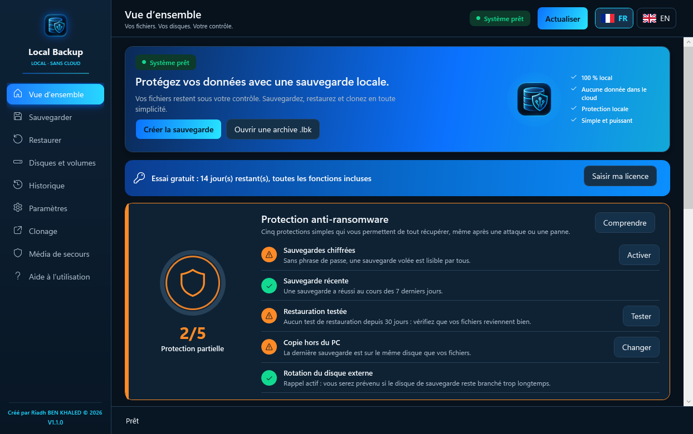
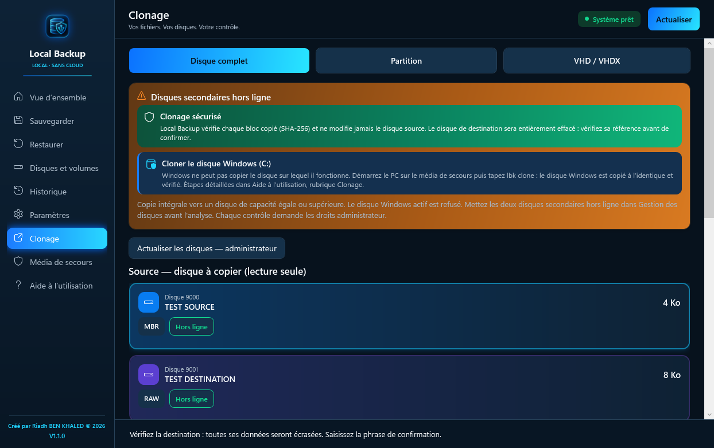
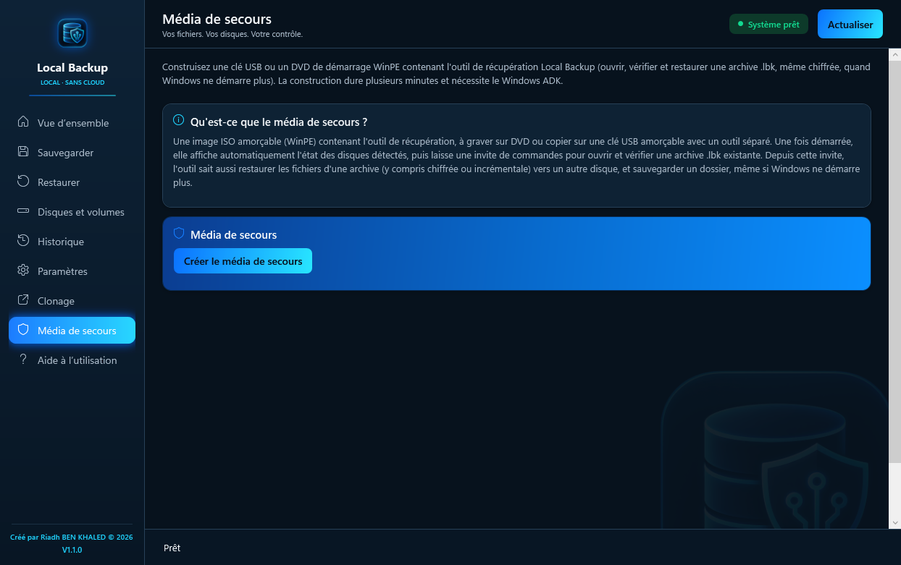
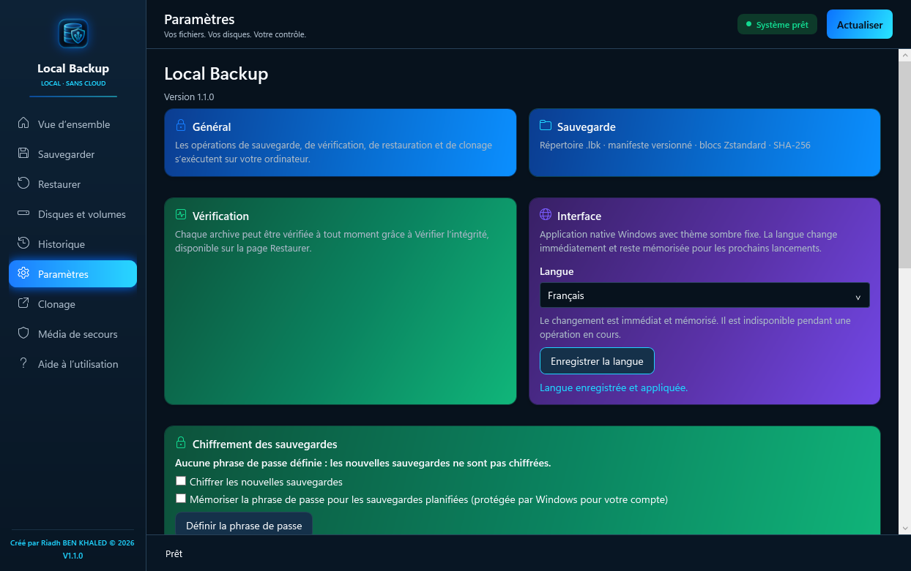
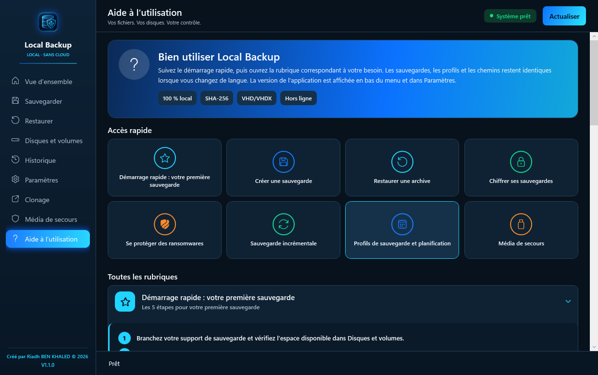

# Local Backup Pro

**La sauvegarde Windows chiffrée et vérifiée, qui reste sur votre PC. Sans cloud. Sans compte. Sans abonnement.**

[Télécharger l'essai gratuit de 14 jours (Windows x64)](https://github.com/Riadh35/local-backup-ai/releases/latest/download/LocalBackupPro-Setup.msi) · [Acheter une licence sur Whop](https://whop.com/apps-361b) · [English](README.md) · [Signaler un problème](https://github.com/Riadh35/local-backup-ai/issues)

Application Windows 10/11 native, **interface en français et en anglais** (choisie à l'installation, modifiable à tout moment). Ce dépôt distribue l'installateur compilé et la documentation ; le code source de l'application n'est pas publié.

<p align="center"></p>

## Ce que fait l'application

| Fonction | Ce que vous obtenez |
|---|---|
| **Sauvegardes chiffrées** | AES-256-GCM avec votre phrase de passe ; les noms de fichiers sont masqués aussi. Sans la phrase de passe, personne ne peut lire la sauvegarde, pas même l'éditeur. |
| **Sauvegardes vérifiées** | Chaque fichier est relu et contrôlé par SHA-256 avant que la sauvegarde soit déclarée réussie. |
| **Test de restauration en un clic** | Restaure l'archive dans un dossier temporaire, compare chaque empreinte, puis nettoie. |
| **Restauration** | Tous les fichiers ou un seul, dans un nouveau dossier ; aucun fichier existant n'est remplacé. |
| **Incrémental et planification** | Seuls les fichiers nouveaux ou modifiés sont copiés ; les profils s'exécutent pendant votre session Windows ; la rétention automatique garde les archives utiles. |
| **Protection anti-ransomware** | Alerte si la sauvegarde est sur le même disque que vos fichiers, rappel de débrancher ou de changer le disque externe, bouclier de protection en 5 points. |
| **Média de secours (WinPE)** | Construisez une ISO amorçable (Windows ADK + module WinPE) pour restaurer vos fichiers quand Windows ne démarre plus, et **cloner votre disque Windows (C:)** vers un nouveau disque, avec vérification SHA-256 complète. |
| **Clonage de disques et VHD/VHDX** | Copie de disques secondaires hors ligne, de partitions et de fichiers VHD/VHDX autonomes ; la source est ouverte en lecture seule et la copie est entièrement relue. |

**Limites :** le clonage copie les partitions telles quelles (sans redimensionnement) ; un disque chiffré par BitLocker doit être déchiffré avant le clonage ; les profils planifiés nécessitent une session Windows ouverte ; ce n'est pas un outil de restauration d'image système complète.

## Essayer — 14 jours, toutes les fonctions

1. Téléchargez **LocalBackupPro-Setup.msi** depuis la [dernière version](https://github.com/Riadh35/local-backup-ai/releases/latest). L'archive ZIP des sources générée automatiquement n'est pas l'application.
2. Installez-la sur Windows 10/11 64 bits et choisissez la langue. L'installateur **n'est pas encore signé** : Windows SmartScreen peut afficher « Windows a protégé votre ordinateur » — cliquez sur **Informations complémentaires**, puis **Exécuter quand même**.
3. Sauvegardez un petit dossier de test vers un disque externe ou un NAS, puis cliquez sur **Tester la restauration**.

Après 14 jours sans licence, seules les nouvelles sauvegardes sont bloquées. **Restaurer, vérifier et tester vos sauvegardes existantes reste toujours possible.**

## Acheter une licence à vie

| Offre | Prix | Postes |
|---|---|---|
| Licence individuelle | 59 €, à vie | 1 PC |
| Petit bureau | 149 €, à vie | jusqu'à 5 PC |

Disponible sur **[Whop](https://whop.com/apps-361b)**. Vous recevez votre clé par e-mail sous 24 heures ; collez-la dans **Paramètres → Licence** ou importez le fichier `.lic`. L'activation fonctionne sans Internet. Toutes les mises à jour 1.x sont incluses.

Une **édition Store** signée (sauvegarde, vérification, restauration, profils) est aussi disponible sur le [Microsoft Store](https://apps.microsoft.com/detail/9phlz9v5p39m).

## Captures d'écran

<p align="center">
  
  
</p>
<p align="center">
  
  
</p>

## Configuration et confidentialité

- Windows 10/11 x64. Autorisation administrateur pour l'installation, VSS et le clonage de disques.
- Windows ADK + module WinPE uniquement pour construire le média de secours.
- Tout fonctionne en local : aucune connexion Internet, aucune télémétrie, aucune publicité. Voir la [politique de confidentialité](PRIVACY.md).

Gardez vos sauvegardes sur un support séparé, et conservez le **dossier `.lbk` entier**. Voir [stockage et récupération des archives](ARCHIVE_FORMAT.md).

## Intégrité de l'installateur

Pour la **v1.1.0**, `LocalBackupPro-Setup.msi` fait 133 672 960 octets. SHA-256 :

```text
c951fd8e1e8dcf98ea3b57b22f69f40222609d71f05cd743d2a2827d4fb600e7
```

Vérifiez avec `Get-FileHash .\LocalBackupPro-Setup.msi -Algorithm SHA256`. Une empreinte identique confirme que le fichier correspond à cette version ; elle ne remplace pas une signature de code.

## Assistance

- Achat et licences : **contact@guardianwall.fr**
- Assistance technique : **support@guardianwall.fr**, ou [ouvrez un ticket](https://github.com/Riadh35/local-backup-ai/issues) avec votre version de Windows, la version de l'application et le message affiché. Ne communiquez jamais votre phrase de passe.

Créé par **Riadh BEN KHALED**.
