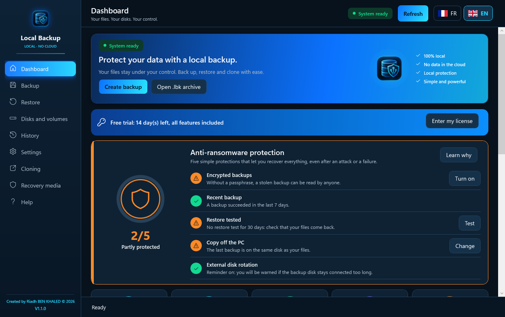
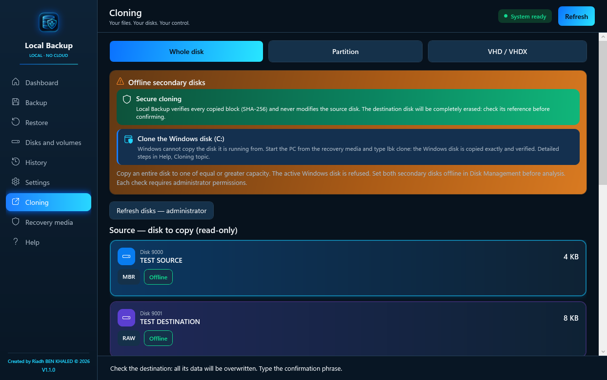
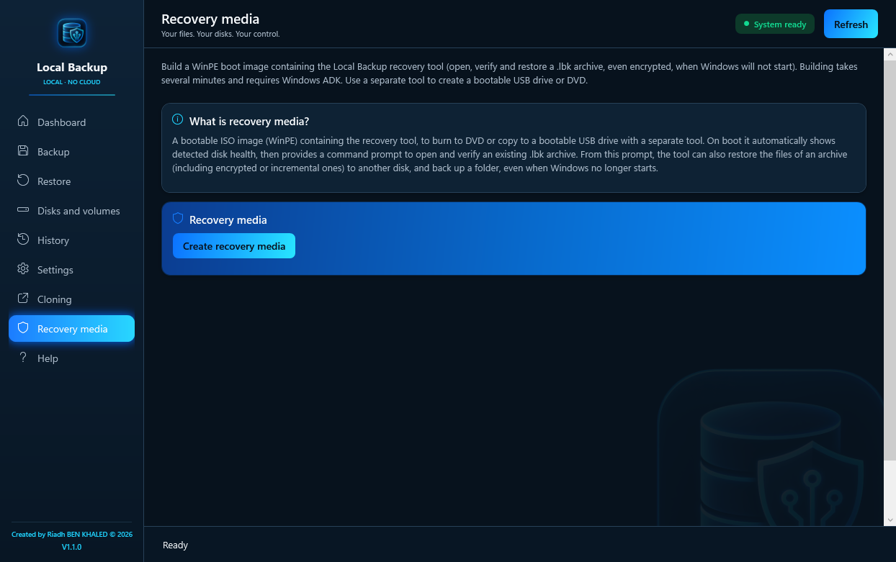
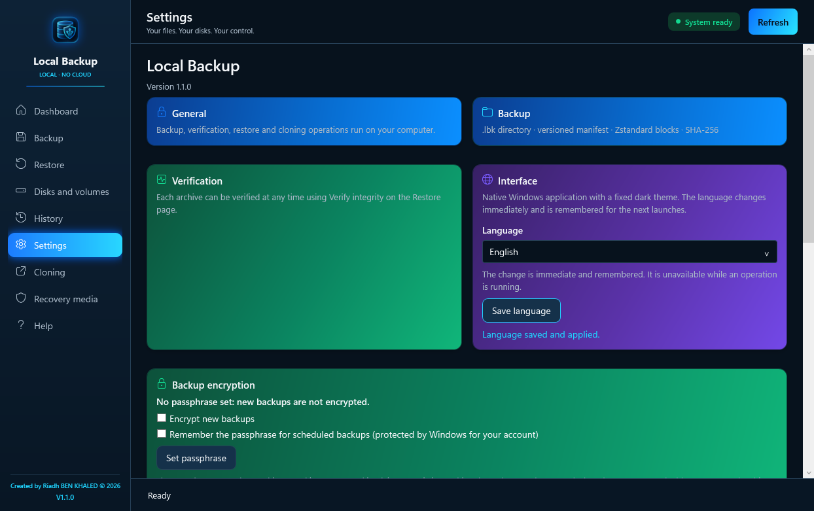
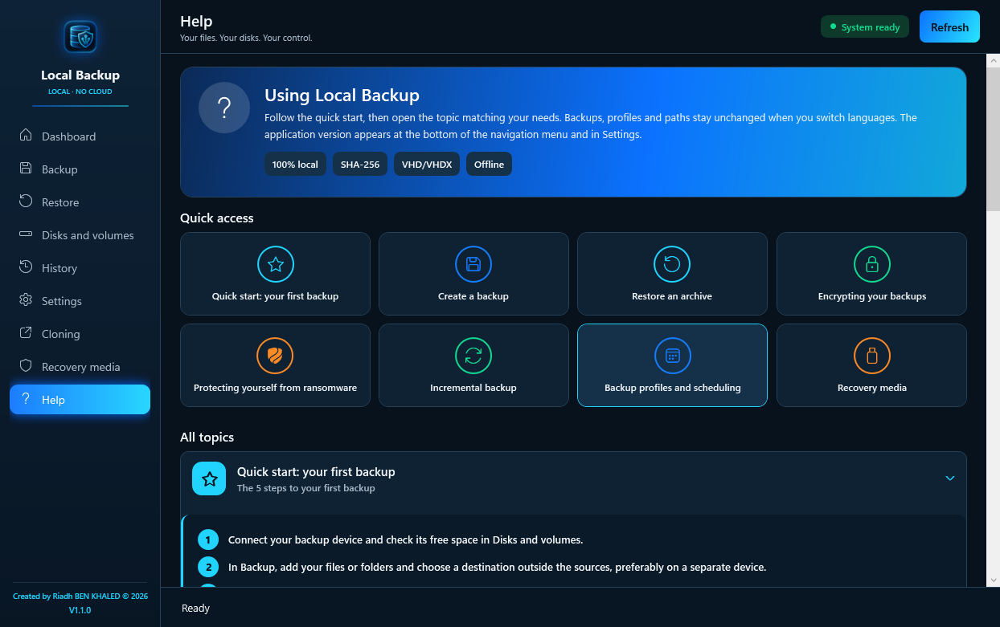

# Local Backup Pro

**Encrypted, verified Windows backup that stays on your PC. No cloud. No account. No subscription.**

[Download the 14-day free trial (Windows x64)](https://github.com/Riadh35/local-backup-ai/releases/latest/download/LocalBackupPro-Setup.msi) · [Buy a license on Whop](https://whop.com/apps-361b) · [Français](README.fr.md) · [Report a problem](https://github.com/Riadh35/local-backup-ai/issues)

Native Windows 10/11 application, **French and English interface** (chosen during installation, switchable at any time). This repository distributes the compiled installer and documentation; the application source code is not published.

<p align="center"></p>

## What it does

| Feature | What you get |
|---|---|
| **Encrypted backups** | AES-256-GCM with your passphrase; file names are hidden too. Without the passphrase nobody can read the backup, not even the publisher. |
| **Verified backups** | Every file is read back and checked with SHA-256 before a backup is reported as successful. |
| **One-click restore test** | Restores the archive into a temporary folder, compares every hash, then cleans up. |
| **Restore** | All files or a single file into a new folder; existing files are never overwritten. |
| **Incremental backups and scheduling** | Only new or changed files are copied; profiles run while you are signed in to Windows; automatic retention keeps the archives you need. |
| **Anti-ransomware protection** | Warns when the backup sits on the same disk as your files, reminds you to unplug or swap the external disk, and shows a 5-point protection shield. |
| **Recovery media (WinPE)** | Build a bootable ISO (Windows ADK + WinPE add-on) to restore files when Windows no longer starts, and to **clone your Windows disk (C:)** to a new disk with full SHA-256 verification. |
| **Disk and VHD/VHDX cloning** | Copy secondary offline disks, partitions and standalone VHD/VHDX files; the source is opened read-only and the copy is fully re-read. |

**Boundaries:** cloning copies partitions as they are (no resizing); a BitLocker-encrypted disk must be decrypted before cloning; scheduled profiles need a signed-in Windows session; this is not a full system-image restore tool.

## Try it — 14 days, every feature

1. Download **LocalBackupPro-Setup.msi** from the [latest release](https://github.com/Riadh35/local-backup-ai/releases/latest). The automatically generated source ZIP is not the application.
2. Install on Windows 10/11, 64-bit, and choose the application language. The installer is **not yet code-signed**: Windows SmartScreen may show "Windows protected your PC" — click **More info**, then **Run anyway**.
3. Back up a small test folder to an external disk or a NAS, then click **Test restore**.

After 14 days without a license, only new backups are blocked. **Restoring, verifying and testing your existing backups always remains possible.**

## Buy a lifetime license

| Offer | Price | PCs |
|---|---|---|
| Single license | €59, lifetime | 1 PC |
| Small office | €149, lifetime | up to 5 PCs |

Available on **[Whop](https://whop.com/apps-361b)**. You receive your license key by e-mail within 24 hours; paste it in **Settings → License** or import the `.lic` file. Activation works offline. All 1.x updates are included.

A signed **Store edition** (backup, verification, restore, profiles) is also available on the [Microsoft Store](https://apps.microsoft.com/detail/9phlz9v5p39m).

## Screenshots

<p align="center">
  
  
</p>
<p align="center">
  
  
</p>

## Requirements and privacy

- Windows 10/11 x64. Administrator approval for installation and for VSS and disk cloning.
- Windows ADK + WinPE add-on only to build the recovery media.
- Everything runs locally: no Internet connection, no telemetry, no advertising. See the [privacy policy](PRIVACY.md).

Keep backups on a separate device, and keep the **whole `.lbk` folder**. See [archive storage and recovery](ARCHIVE_FORMAT.md).

## Installer integrity

For **v1.1.0**, `LocalBackupPro-Setup.msi` is 133,672,960 bytes. SHA-256:

```text
c951fd8e1e8dcf98ea3b57b22f69f40222609d71f05cd743d2a2827d4fb600e7
```

Check with `Get-FileHash .\LocalBackupPro-Setup.msi -Algorithm SHA256`. A matching hash confirms the file matches this release; it does not replace code signing.

## Support

- Purchase and licenses: **contact@guardianwall.fr**
- Technical support: **support@guardianwall.fr**, or [open an issue](https://github.com/Riadh35/local-backup-ai/issues) with your Windows version, application version and the message shown. Never share your passphrase.

Created by **Riadh BEN KHALED**.
